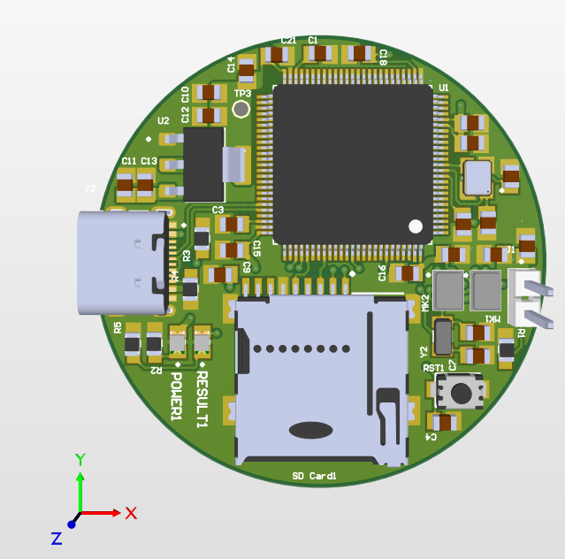
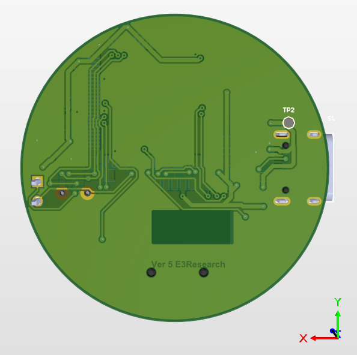
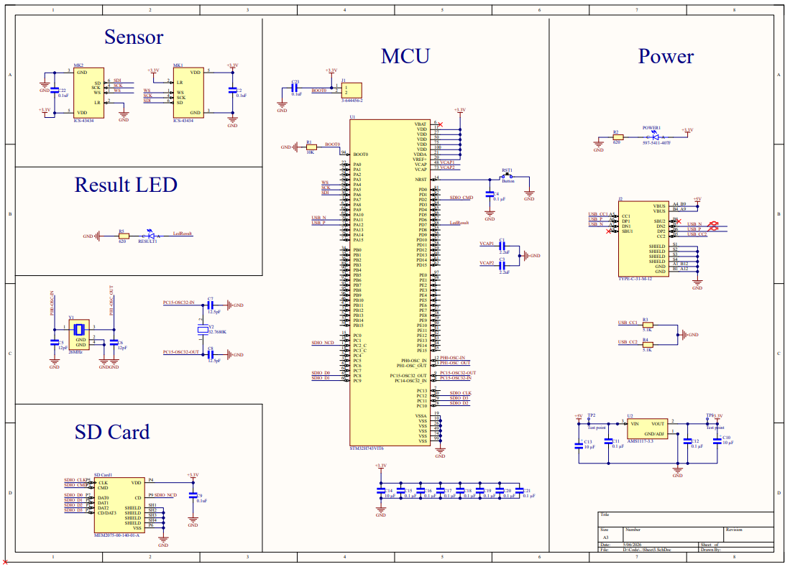
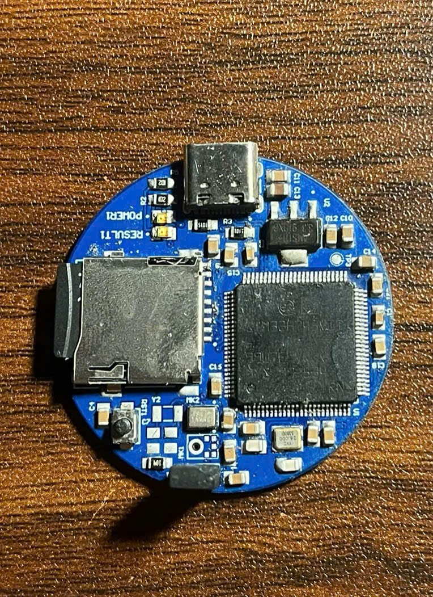
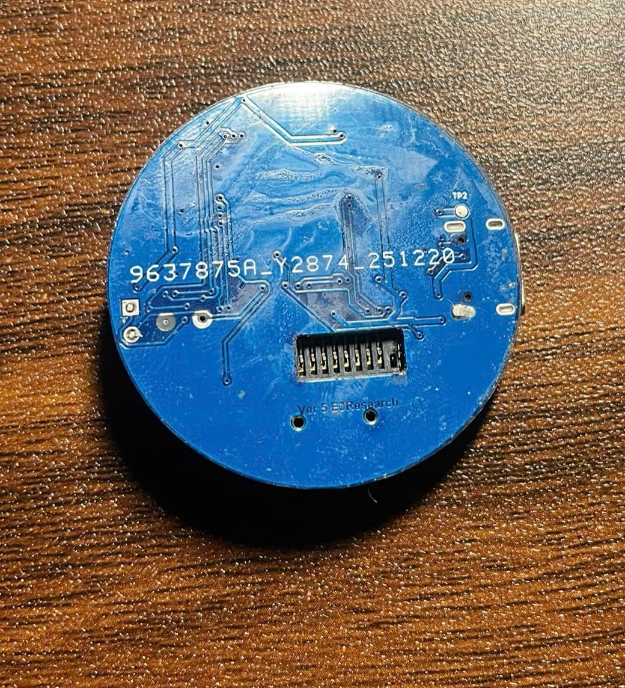

# Altium: Hardware Design

Schematic and PCB design of the **digital heart-sound acquisition board**, made in **Altium Designer**.

| 3D view: top side (Hình 2.4) | 3D view: bottom side (Hình 2.5) |
|---|---|
|  |  |

## Folder layout

```
Altium/
├── HeartSoundI2S/                         # ★ Final design: STM32H743VIT6 + ICS-43434 (I2S)
│   ├── HeartSoundProject/                 #   Main working project (most recent: Ver5)
│   │   ├── HeartSoundSTMH7I2S.PrjPcb      #   Altium project file. Open this one.
│   │   ├── Sheet3.SchDoc                  #   Schematic (Sensor / MCU / Power / SD card / LED / USB-C)
│   │   ├── Ver5.PcbDoc, Ver5/             #   Latest PCB layout
│   │   ├── Ver4/                          #   Previous layout revision
│   │   ├── HeartSoundSTMH7I2S.SCHLIB      #   Schematic symbol library
│   │   ├── Ver5.PcbLib                    #   Footprint library
│   │   ├── HeartSoundSTMH7I2S.IntLib      #   Compiled integrated library
│   │   ├── Rule.RUL                       #   Design-rule set (clearance, width, via…)
│   │   ├── Ver5.Cam, Ver5(NCDrill).Cam    #   CAM files (Gerber / NC drill) for fabrication
│   │   └── Project Outputs for …/         #   Generated fabrication outputs
│   └── PCB_Project/                       #   Earlier working copy with layout history Ver1 → Ver5
│       ├── Ver1.PcbDoc, Ver3.PcbDoc, PCB3.PcbDoc
│       ├── Ver4.PcbDoc, Ver4(AD).PcbDoc   #   "AD" = variant prepared for the board house
│       ├── JobVer4.OutJob                 #   Output job (Gerber, drill, BOM, pick & place)
│       └── *.Cam, *NCFile.Cam
└── HeartSoundClone/                       # Early prototype / reference design used for learning
    ├── HeartSoundClone.PrjPcb
    ├── Sheet2.SchDoc
    ├── PCB1.PcbDoc, PCB2.PcbDoc, PCB2.PcbLib
    └── HeartSoundClone.SCHLIB
```

> The `History/`, `__Previews/` and `Project Logs …` folders are generated automatically by Altium. You can ignore them.

## Schematic blocks



| Block | Main parts | Notes |
|---|---|---|
| **Sensor** | 2 × ICS-43434 (MK1, MK2) | Digital I2S output (24-bit), SNR 64–66 dB, 20 Hz to 20 kHz. The L/R pin selects the left or right channel, so two microphones can share one SD line. Each mic has a 0.1 µF decoupling capacitor. |
| **MCU** | STM32H743VIT6 (LQFP-100) | Cortex-M7 @ 480 MHz, 2 MB Flash, 1 MB RAM. HSE crystal + 32.768 kHz LSE, BOOT0 resistor, reset button, VCAP capacitors. |
| **Power** | USB-C receptacle, AMS1117-3.3 LDO | 5 V VBUS → 3.3 V for all logic. 10 µF and 0.1 µF bulk and decoupling capacitors. Power LED. |
| **SD Card** | microSD socket (SDMMC1, 4-bit) | Stores long recordings for offline analysis and future data collection. |
| **Result LED** | LED + resistor on **PA1** | Turns on when the model predicts *Abnormal*. |
| **Debug** | SWD header, USART3 (PB10/PB11) | Programming and UART log at 115200 baud. |

### MCU pin mapping (from the firmware `.ioc`)

| Function | Pin |
|---|---|
| I2S1_WS (LRCLK) | PA4 |
| I2S1_CK (BCLK) | PA5 |
| I2S1_SDI (data from mic) | PA6 |
| Abnormal LED | PA1 |
| USART3_TX / RX | PB10 / PB11 |
| SDMMC1 | PC8–PC12, PD2 (standard SDMMC1 pins) |

## PCB design notes

- **Round 2-layer board.** All components are on the **top** side.
- **Acoustic via.** A through-hole is drilled under the sound port of the ICS-43434 (a bottom-port mic). Sound travels from the bottom of the board to the sensor.
- **Flat bottom side.** The bottom has no components, so it can rest directly on the patient's chest at the auscultation points (aortic, pulmonic, tricuspid, mitral).
- **Noise control.** A continuous ground plane, short I2S traces, and the LDO and digital switching parts are kept away from the microphone.

| Real board (front) | Real board (back) |
|---|---|
|  |  |

## How to open, edit and export

1. Open `HeartSoundI2S/HeartSoundProject/HeartSoundSTMH7I2S.PrjPcb` in Altium Designer (version 20 or later recommended).
2. Schematic: `Sheet3.SchDoc`. Layout: `Ver5.PcbDoc`.
3. To regenerate fabrication files, run the OutJob (`PCB_Project/JobVer4.OutJob`) or *File → Fabrication Outputs → Gerber Files / NC Drill Files*.
4. To export figures for the documentation:
   - Schematic → *File → Smart PDF*, or *File → Export → Save as image*
   - 3D view → press `3` in the PCB editor, then *View → … → Copy/Export 3D image*, or take a screenshot

## Revision history (summary)

| Revision | Location | Notes |
|---|---|---|
| HeartSoundClone | `HeartSoundClone/` | First prototype for learning the workflow |
| Ver1 → Ver3 | `PCB_Project/` | First layouts of the STM32H7 + I2S board |
| Ver4 / Ver4(AD) | `PCB_Project/`, `HeartSoundProject/Ver4` | Board sent for fabrication (CAM + NC drill) |
| **Ver5** | `HeartSoundProject/Ver5.PcbDoc` | Final round board used in the thesis |
