# Model: Heart Sound Classification (PyTorch → ONNX → TFLite)

This folder holds everything on the AI side of the project:

- signal pre-processing and MFCC feature extraction
- training and evaluating many tiny CNN architectures
- pruning, quantization and conversion to a microcontroller-friendly `.tflite`

All notebooks were developed on **Google Colab** with **Google Drive** as storage.

---

## Contents

- [Folder layout](#folder-layout)
- [Notebook guide (which one to run)](#notebook-guide-which-one-to-run)
- [Feature datasets: Log-Mel and MFCC, 13 and 39 channels](#feature-datasets-log-mel-and-mfcc-13-and-39-channels)
- [Pipeline](#pipeline)
  - [1. Data and split](#1-data-and-split)
  - [2. Pre-processing](#2-pre-processing)
  - [3. MFCC feature extraction](#3-mfcc-feature-extraction)
  - [4. LightWeight CNN architecture](#4-lightweight-cnn-architecture)
  - [5. Training setup](#5-training-setup)
  - [6. Results](#6-results)
  - [7. Pruning, quantization and conversion](#7-pruning-quantization-and-conversion)
- [How to reproduce](#how-to-reproduce)
- [Notes & known limitations](#notes--known-limitations)

---

## Folder layout

```
Model/
├── [VerX][…]LogExtracMFCC.ipynb        # Feature extraction (filter, augment, Log-Mel + MFCC-13/39, build .h5)
├── [VerX][MFCC] Train.ipynb            # Training + evaluation (Ver1 → Ver17, Ver17 = final)
├── [VerX][MFCC][LightCNN] ConvertToTFLite  # Prune → fine-tune → ONNX → TFLite (Jupyter notebooks, no extension)
├── stm32ai_quantize_onnx_benchmark.ipynb   # ONNX static INT8 quantization + STM32 benchmark experiments
├── Check Model.ipynb                   # Quick model loading and inspection
├── 2-deep-learning-sequence-models.ipynb   # RNN/LSTM experiments (reference)
│
├── config/        # JSON configs for the script-based trainer (cnn, crnn, crnn_10fold, lstm, vgg)
├── data_loader/   # HeartSoundDataSet, MinimumOccupancySampler (class balancing), HeartSoundDataLoader
├── model/         # model.py (simple_cnn, CRNN, LSTM, VGG…), loss.py, metric.py
├── trainer/       # Trainer class (train/valid loop, checkpoints, TensorBoard)
├── utils/         # audio_feature_extractor.py (LogMel, MFCC, SNV), util.py (Butterworth, read_audio, …)
│
├── mfcc_39_features/              # MFCC-39 (39 × 333): 3,240 originals + 1,596 augmented (*_aug0..2)
├── mfcc_39_features_validation/   # MFCC-39 for the 301-record test set
├── mfcc_13_features/              # MFCC-13 (13 × 100): same records, static coefficients only
├── mfcc_13_features_validation/   # MFCC-13 for the test set
├── mfcc_features/                 # MFCC-39 from the earlier Ver2–Ver4 runs (unprefixed names)
├── mfcc_features_validation/
├── logmel_13_features_validation/ # Log-Mel (128 × T, full length) written by the MFCC-13 notebook
├── logmel_39_features_validation/ # Log-Mel (128 × T) written by the MFCC-39 notebook
├── logmel_features_validation/    # Log-Mel (128 × T) from the earlier runs
│                                  # → see "Feature datasets" below for the full description
│
├── saved/         # Logs + checkpoints per architecture (Light_CNN, lightweight_cnn, MobileNetV3,
│                  #   shufflenet, densenet201, googlenet, inception, LSTM, VGG11, simple)
├── TFLITE/        # Exported .pth / .onnx / .tflite (see TFLITE/README.md)
└── models/        # Standalone ONNX static INT8 model
```

> The code framework in `config/`, `data_loader/`, `model/`, `trainer/` and `utils/` follows the
> [pytorch-template](https://github.com/victoresque/pytorch-template) structure. The notebooks contain inline copies of these classes so that each notebook can run alone on Colab.

---

## Notebook guide (which one to run)

| Step | Notebook | Purpose |
|---|---|---|
| 1a | [`[Ver5][MFCC]LogExtracMFCC.ipynb`](<[Ver5][MFCC]LogExtracMFCC.ipynb>) | **Final MFCC-39 dataset** (`N_MFCC = 39`, `T_FIXED = 333`): band-pass, augmentation, patient-level split, writes `mfcc_39_*` / `label_39_*` (used by Ver13–Ver17 and ConvertToTFLite) |
| 1b | [`Copy of [Ver5][MFCC13]LogExtracMFCC.ipynb`](<Copy of [Ver5][MFCC13]LogExtracMFCC.ipynb>) | **Final MFCC-13 dataset** (`N_MFCC = 13`, `T_FIXED = 100`): same pipeline, writes `mfcc_13_*` / `label_13_*` (used by Ver12) |
| 2 | [`[Ver17][MFCC] Train.ipynb`](<[Ver17][MFCC] Train.ipynb>) | **Final training**: all tiny architectures (LightCNN V2, MobileNetV3-Tiny, ShuffleNetV2-Tiny/Nano, SqueezeNet-Tiny, Inception-Tiny, GoogLeNet-Tiny, DenseNet-Tiny, Xception-Tiny) + test evaluation (ROC, confusion matrix, optimal threshold) |
| 3 | [`[Ver10][MFCC][LightCNN] ConvertToTFLite`](<[Ver10][MFCC][LightCNN] ConvertToTFLite>) | **Final conversion**: L1 unstructured pruning 20 % → fine-tune → ONNX → TFLite INT8 (PTQ with calibration) → accuracy check |
| opt. | [`stm32ai_quantize_onnx_benchmark.ipynb`](stm32ai_quantize_onnx_benchmark.ipynb) | ONNX-Runtime static quantization and ST Edge AI benchmark |

Older versions (`Ver1 … Ver16`, `Example*`, `[Ver2]…[Ver5][MFCC39]LogExtracMFCC`) are kept as the experiment history: the Log-Mel features, other loss functions, VGG/CRNN/LSTM baselines, and earlier conversion attempts.

---

## Feature datasets: Log-Mel and MFCC, 13 and 39 channels

Two feature types were built from the same filtered audio (2 kHz, Butterworth 20–600 Hz, 25 ms window, 15 ms hop). Each type was produced in a **13-channel** and a **39-channel** version, so the input representation could be compared before the model was chosen.

**Normal recording (`a0007`)**: waveform, Log-Mel spectrogram and MFCC (Hình 3.7)

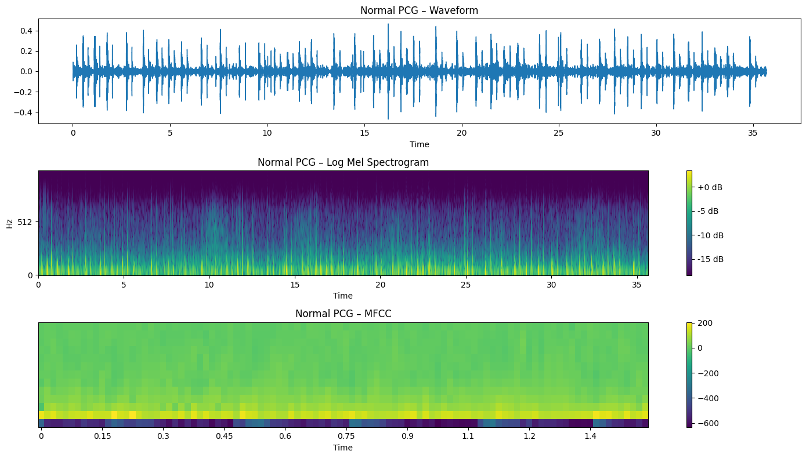

**Abnormal recording (`a0001`)**: waveform, Log-Mel (original and augmented) and MFCC (Hình 3.8)

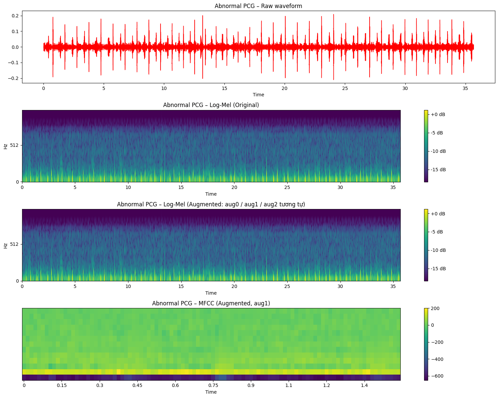

### How the datasets differ

| | **Log-Mel** | **MFCC-13** | **MFCC-39** ★ |
|---|---|---|---|
| What it is | Mel power spectrogram → natural log | DCT of the log-Mel → first 13 cepstral coefficients | 13 static + 13 Δ + 13 ΔΔ |
| Extractor | `LogMelExtractor(mel_bins=128, log=True, snv=False)` | `MfccExtractor(n_mfcc=13)` | `MfccExtractor(n_mfcc=39)`: `librosa.feature.mfcc(n_mfcc=13)` + `librosa.feature.delta` (order 1 and 2) |
| Frequency axis | 128 Mel bands | 13 coefficients | 39 = 3 × 13 |
| Time axis on disk | **Full recording**, not trimmed (e.g. `a0001` → 2,378 frames, `b0086` → 534) | **100 frames** (≈ 1.5 s) | **333 frames** (≈ 5 s) |
| Length handling | Done in the **DataLoader**: random 5 s crop (train), center crop (eval), wrap-pad if shorter | Done at extraction: truncate, or `np.pad(mode="wrap")` | Same as MFCC-13 |
| Normalization | SNV in the DataLoader (`norm: true`) | SNV at extraction (`snv=True`) | SNV at extraction (`snv=True`) |
| Δ / ΔΔ | Optional in the DataLoader (`delta: true`) → stacked as 3 channels | No | Already included (rows 13–38) |
| Model input | `(B, 3, 128, 333)` with Δ, or `(B, 1, 128, 333)` without | `(B, 1, 13, 100)` | `(B, 1, 39, 333)` |
| Size per sample (float32) | 128 × T × 4 B (1.2 MB for a 36 s record). Model input after cropping: 128 × 333 × 3 = 500 KB. | 5.2 KB | 51.9 KB |
| Used by | `[Ver2] Train`, `Copy of [Ver4][MFCC] Train`: simple CNN, VGG11, CRNN, BiLSTM (`config_cnn`, `in_channel: 3`) | `[Ver1][MFCC][VH] Train`, `[Ver12][MFCC13] Train` (Simple CNN, LightCNN) | `[Ver9]`–`[Ver17]` Train, all tiny models, **final LightCNN** |

> The **"13" and "39" in the Log-Mel folder names do not mean 13 or 39 Mel bands.** Both notebooks call `LogMelExtractor` with 128 bands and save its output next to the MFCC files. `logmel_13_features_validation/` and `logmel_39_features_validation/` therefore hold the same 128 × T matrices. The suffix only shows which notebook run wrote them.

### Why MFCC-39 was selected

- **Smallest input that keeps the information.** 39 × 333 = 13 k values per sample, compared with 128 × 333 × 3 = 128 k for Log-Mel + Δ + ΔΔ. That is about 10× less RAM for the input tensor on the MCU (50.7 KiB with MFCC-39).
- **Decorrelated features.** The DCT removes the correlation between neighbouring Mel bands, so a model with 8 k parameters can learn from them.
- **Dynamics included.** The Δ / ΔΔ rows capture how the spectrum changes from S1 to S2 and over each cycle, which a static MFCC-13 cannot show.
- **Enough context.** 333 frames (≈ 5 s) cover 4–7 heart cycles. MFCC-13's 100 frames (≈ 1.5 s) cover only 1–2.
- **Feasible on the MCU.** CMSIS-DSP has ready-made Mel-filterbank and DCT functions (`feature_extraction.h`), and 13 + Δ + ΔΔ can be updated one frame at a time.

### Dataset sizes

There were two generations of datasets:

- **Early (Ver2–Ver4 notebooks: Log-Mel, first MFCC-13/39).** All 3,240 records plus 3 augmented copies of every abnormal record (665 × 3) went into `label_balanced.csv`, for **5,235 samples** (2,575 normal / 2,660 abnormal). The DataLoader then held out 10 % (`validation_split: 0.1`) at random.
- **Final (`[Ver5][MFCC]` and `Copy of [Ver5][MFCC13]`).** A record-level split with `train_test_split(test_size=0.2, stratify=label, random_state=42)` is done **before** augmentation, so augmented copies never leak into validation. MFCC-13 and MFCC-39 share exactly this split. Only the extractor differs.

Numbers for the final split:

| | Records | Normal | Abnormal | Notes |
|---|---|---|---|---|
| `label.csv` (all of `training-a…f`) | 3,240 | 2,575 | 665 | Labels come from the `.hea` files |
| Train (before augmentation) | 2,592 | 2,060 | 532 | 80 % |
| **Train (after augmentation)** | **4,188** | 2,060 | 2,128 | 532 abnormal × 3 copies (`_aug0.._aug2`) → about 1 : 1 |
| Internal validation | 266 | 133 | 133 | 20 % (515 normal / 133 abnormal), down-sampled to balance |
| Test (`physionet2016/validation/`) | 301 | 150 | 151 | Never augmented |

The `mfcc_39_features/` and `mfcc_13_features/` folders each hold **4,836 files**: 3,240 original records (train + validation) plus 1,596 augmented files (532 × 3). The label CSVs choose which files belong to which split.

> The saved cell outputs in `[Ver5][MFCC]LogExtracMFCC.ipynb` come from an earlier run with 2 augmented copies and an unbalanced validation set (train 3,656 / val 648). The `.npy` files in the repository (`_aug0.._aug2`) and the thesis numbers (4,188 / 266) correspond to the 3-copy, balanced setting shown in the MFCC-13 notebook.

### Augmentation used in each notebook

| Notebook | Classes | Transforms (each applied with p = 0.5) |
|---|---|---|
| `Copy of [Ver5][MFCC13]…`, `[Ver5][MFCC39]…` | Abnormal only | Gaussian noise (σ = 0.005·std), time shift ±0.05·fs (zero-filled), pitch shift ±2 semitones |
| `[Ver5][MFCC]…` (active `augment_audio` is the one in cell 13; the cell 12 version is commented out) | Any call with `is_augment=True`, both classes | Gaussian noise (σ = 0.005·std), circular time shift ±0.05·fs (no pitch shift) |
| `[Ver2]…LogExtracMFCC` (Log-Mel era) | Abnormal (3 copies each) | Same as the first row. The same augmented audio feeds both the Log-Mel and MFCC files. |

### Generated files (written to `data/`, not in the repository)

`.h5` and `.npz` files are in `.gitignore`. Running the notebooks recreates them.

| File | Contents |
|---|---|
| `label.csv` | `filename,label` for all 3,240 training records |
| `label_39_clean.csv`, `label_39_train.csv`, `label_39_val_internal.csv` | Split before augmentation |
| `label_39_train_augmented.csv`, `label_39_val_clean.csv` | Final train / validation lists (IDs with `_augN`) |
| `label_39_validation.csv` | Test set (301) |
| `mfcc_39_train.h5`, `mfcc_39_val_internal.h5`, `mfcc_39_features_validation.h5` | One HDF5 dataset per record, key = file stem, value = `float32 (39, 333)` |
| `*_13_*` | Same files for MFCC-13 `(13, 100)` |
| `logmel_features.h5`, `logmel_features_validation.h5` | Log-Mel `(128, T)` used by the Ver2/Ver4 Log-Mel experiments |
| `dataset_*.npz` | `x` / `y` arrays (for example `X = (4188, 13, 100)`) for quick loading or Keras tests |

Read one sample:

```python
import h5py, pandas as pd
df = pd.read_csv("data/label_39_train_augmented.csv")
with h5py.File("data/mfcc_39_train.h5", "r") as f:
    x = f[df.filename[0]][()]      # (39, 333) float32, already SNV-normalized
    print(x.shape, df.label[0])    # rows 0-12 MFCC, 13-25 Δ, 26-38 ΔΔ
```

---

## Pipeline

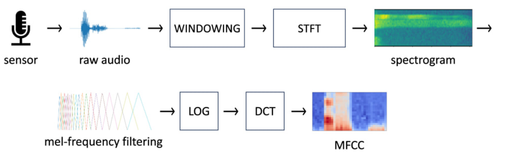

### 1. Data and split

Source: **PhysioNet/CinC Challenge 2016**. See [`../physionet2016/README.md`](../physionet2016/README.md).

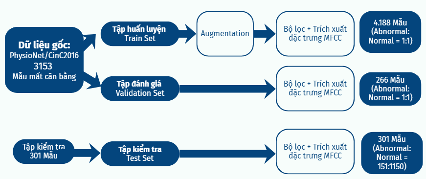

| Set | Size | Abnormal : Normal | How it is built |
|---|---|---|---|
| Train | **4,188** (after augmentation) | 1 : 1 | 80 % of `training-a…f` (patient-level, stratified, `random_state=42`) + 3 augmented copies of each abnormal record |
| Validation (internal) | **266** | 133 : 133 | 20 % split, down-sampled to a balanced set, no augmentation |
| Test | **301** | 151 : 150 | Official PhysioNet `validation/` folder, no augmentation |

Labels: `-1 → 0 (Normal)`, `1 → 1 (Abnormal)`, read from `REFERENCE.csv`.

### 2. Pre-processing

| Step | Setting |
|---|---|
| Resample | 2,000 Hz |
| Band-pass | Butterworth **IIR, 4th order, 20–600 Hz** (`scipy.signal.butter` + `lfilter`) |
| Augmentation (train only) | Gaussian noise (σ = 0.005·std), time shift (±0.05·fs), and pitch shift (±2 semitones) in the abnormal-only variant. See [Augmentation used in each notebook](#augmentation-used-in-each-notebook). Mixup (α = 0.05) is also applied during training. |

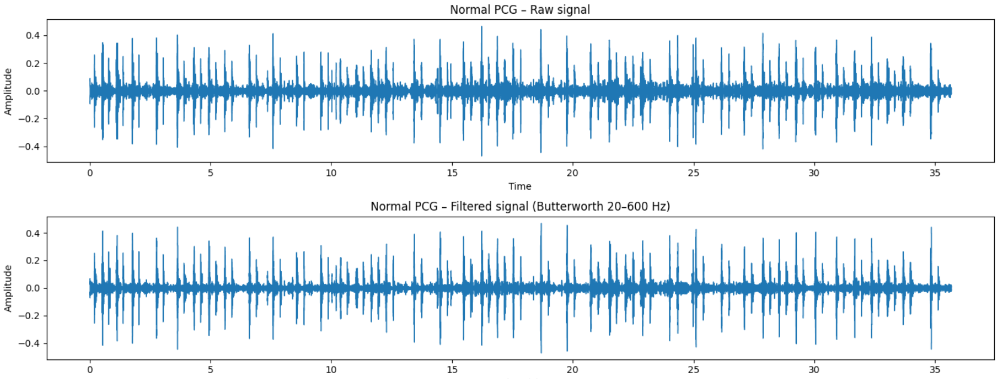

### 3. MFCC feature extraction

Implemented in `MfccExtractor()` (notebook) and `utils/audio_feature_extractor.py`.

| Parameter | Value |
|---|---|
| Window | Hamming, **25 ms** |
| Hop | **15 ms** |
| Mel filterbank | 128 triangular filters (librosa default) |
| Coefficients | 13 static + 13 Δ + 13 ΔΔ = **39** |
| Normalization | Standard Normal Variate (z-score over the whole matrix) |
| Fixed length | **333 frames** (≈ 5 s). Longer signals are truncated. Shorter ones are padded (`np.pad(mode="wrap")`). |
| Output | `float32` array **(39, 333)** saved as `.npy`, then packed into `.h5` |

### 4. LightWeight CNN architecture

Class `LightweightHeartSoundCNN_V2` (in `[Ver17][MFCC] Train.ipynb`). It has **8,026 parameters** and no residual connections, which keeps it simple to quantize to INT8.

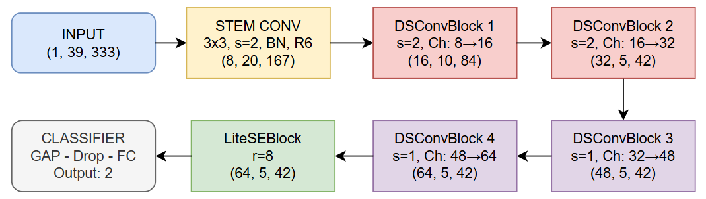

| Layer | Type | Output shape (C, H, W) | Params |
|---|---|---|---|
| Input | MFCC | (1, 39, 333) | – |
| Stem | Conv 3×3, s=2 → BN → ReLU6 | (8, 20, 167) | 88 |
| DS1 | DW 3×3 s=2 → BN → PW 1×1 → BN → ReLU6 | (16, 10, 84) | 248 |
| DS2 | DSConv, s=2 | (32, 5, 42) | 752 |
| DS3 | DSConv, s=1 | (48, 5, 42) | 1,984 |
| DS4 | DSConv, s=1 | (64, 5, 42) | 3,728 |
| LiteSE | GAP → FC(64→8) → ReLU → FC(8→64) → Sigmoid → scale | (64, 5, 42) | 1,096 |
| Head | GAP → Dropout → FC(64→2) | (2) | 130 |
| **Total** | | | **8,026** |

Design choices:

- Channels double early (8 → 16 → 32) so the network learns quickly, then grow slowly (32 → 48 → 64) to limit overfitting.
- Strides are used only in DS1 and DS2, which keeps a 5 × 42 map that is still large enough to see S1/S2 patterns.
- The SE block learns which frequency channels matter (murmur bands).
- GAP replaces Flatten, so the head has only 130 parameters.

### 5. Training setup

From `config_light_cnn_v2`:

| Item | Value |
|---|---|
| Optimizer | AdamW (lr 2e-4, weight decay 1e-3, amsgrad) |
| Scheduler | Linear warm-up 10 epochs + cosine decay (lr_min 1e-6) |
| Loss | Combined Focal + Cross-Entropy with label smoothing (`combined_loss`) |
| Batch size | 32 |
| Epochs | 200 (early stopping patience 25, monitored on `val_F1_score`) |
| Regularization | Dropout, Mixup (α = 0.05), gradient clipping 1.0 |
| Checkpoint | `saved/lightweight_cnn/models/Physionet_lightweight_cnn/<MMDD_HHMMSS>/model_best.pth` |

#### Training and validation loss (Hình 3.11)

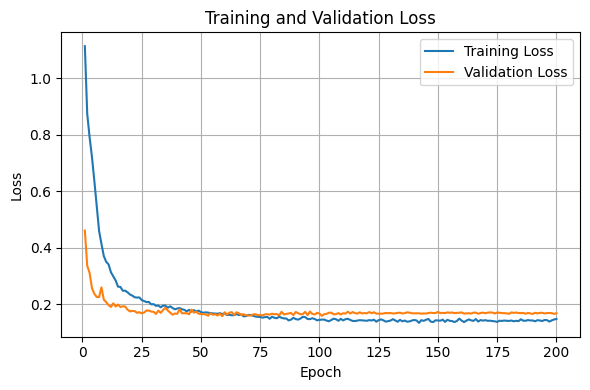

Loss falls sharply in the first 25–50 epochs, then levels off at about 0.15–0.2. The gap between training and validation loss stays small, so the model is not overfitting.

#### Training and validation accuracy (Hình 3.12)

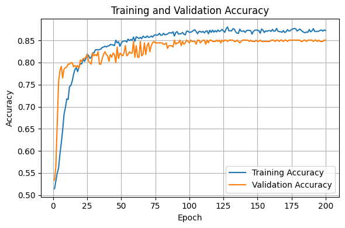

Accuracy rises from about 0.52 to 0.80 within 25 epochs. It then settles at about 87–88 % on training data and about 85 % on validation data.

#### Validation sensitivity (Hình 3.13)

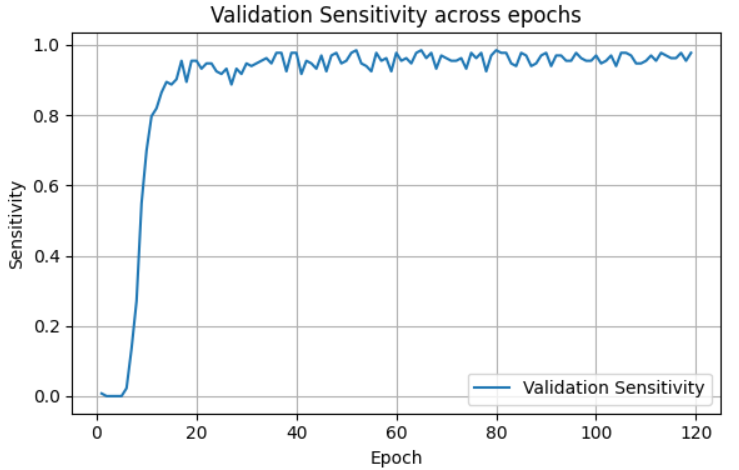

Sensitivity passes 0.9 after about 10 epochs and stays near 0.95–1.0. Very few abnormal recordings are missed, which is the most important requirement for a screening device.

#### Validation F1-score (Hình 3.14)

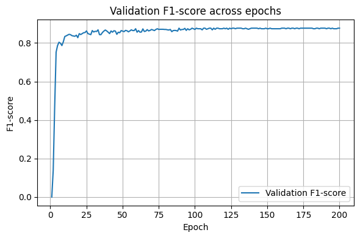

F1-score reaches about 0.8 by epoch 25 and stays stable, so precision and recall are balanced.

### 6. Results

Test set (301 records). The decision threshold is tuned on the ROC curve (best = **0.4414**).

| Metric | Value |
|---|---|
| Accuracy | 90.70 % |
| Sensitivity (Recall) | 91.39 % |
| Specificity | 90.00 % |
| F1-score | 0.9079 |
| AUC | 0.9627 |
| Confusion matrix | TN 135 · FP 15 · FN 13 · TP 138 |

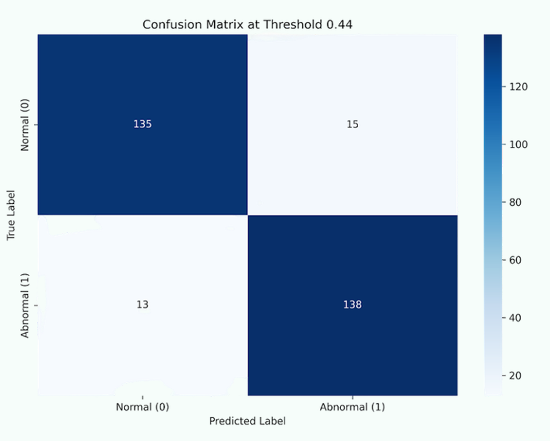

Comparison with other tiny models (same pipeline):

| Model | Acc | Sens | Spec | F1 | AUC | Size (MB) |
|---|---|---|---|---|---|---|
| SqueezeNet | 0.8704 | 0.9536 | 0.7867 | 0.8807 | 0.9427 | 11.22 |
| ShuffleNet | 0.9336 | 0.9470 | 0.9200 | 0.9346 | 0.9660 | 0.74 |
| ShuffleNetV2 | 0.8937 | 0.9470 | 0.8400 | 0.8994 | 0.9379 | 0.47 |
| Inception Tiny | 0.8837 | 0.8278 | 0.9400 | 0.8772 | 0.9459 | 0.36 |
| GoogleNet | 0.8239 | 0.8808 | 0.7667 | 0.8339 | 0.9117 | 0.38 |
| DenseNet201 | 0.9003 | 0.9007 | 0.9000 | 0.9007 | 0.9558 | 0.41 |
| Xception | 0.9635 | 0.9669 | 0.9600 | 0.9637 | 0.9785 | 0.60 |
| MobileNet | 0.9435 | 0.9338 | 0.9533 | 0.9431 | 0.9706 | 0.33 |
| **Lightweight CNN** | 0.9070 | 0.9139 | 0.9000 | 0.9079 | 0.9627 | **0.30** |

### 7. Pruning, quantization and conversion

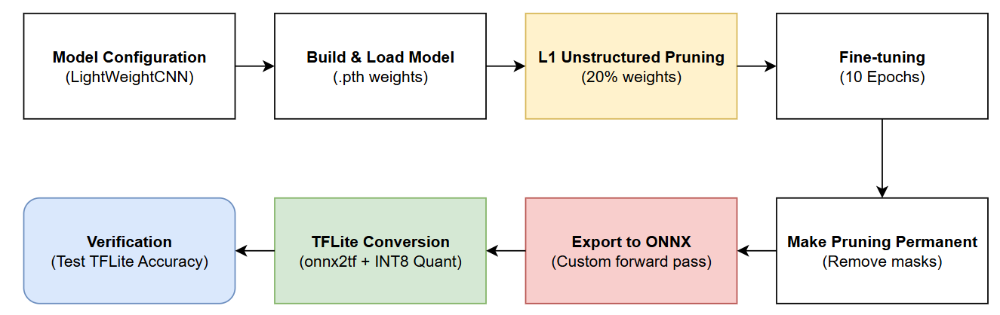

```
model_best.pth
  → torch.nn.utils.prune.global_unstructured(L1, amount=0.2)   # Conv2d + Linear weights
  → fine-tune (Adam 1e-4, CosineAnnealing, AsymmetricFocalLoss)
  → prune.remove()                                             # make the pruning permanent
  → torch.onnx.export(opset 17, input (1, 39, 333), static shapes, logits output)
  → onnxsim / onnxruntime check
  → TensorFlow SavedModel → TFLiteConverter
       representative_dataset = 300 calibration samples from mfcc_39_train.h5
       INT8 weights, float32 input/output
  → *.tflite  →  X-CUBE-AI
```

| | Unstructured pruning (selected) | Structured pruning |
|---|---|---|
| Model size | 24.80 KB | 25.80 KB |
| Accuracy | 84.88 % | 83.46 % |
| Sensitivity | **83.46 %** | 80.07 % |
| Specificity | 85.24 % | 86.70 % |

Unstructured pruning was kept because sensitivity (fewer missed abnormal cases) matters most in screening.

---

## How to reproduce

1. **Paths.** Upload this folder to `MyDrive/AutomaticHeartSoundClassification-main` and the dataset to `MyDrive/physionet2016`, or edit `PROJECT_PATH` / `DATASET_PATH` in each notebook.
2. **Feature extraction.** Run `[Ver5][MFCC]LogExtracMFCC.ipynb` from top to bottom (MFCC-39). It produces `data/label_39_train_augmented.csv`, `data/mfcc_39_train.h5`, `data/mfcc_39_val_internal.h5` and `data/mfcc_39_features_validation.h5`. For MFCC-13, run `Copy of [Ver5][MFCC13]LogExtracMFCC.ipynb` instead, which writes the `*_13_*` files.
3. **Training.** In `[Ver17][MFCC] Train.ipynb`, set `current_config = config_light_cnn_v2` and run the *Training* and *Test* sections.
4. **Conversion.** In the ConvertToTFLite notebook, set `MODEL_NAME = "Light_CNN"` and `TIMESTAMP = "<your run>"`. The first cell asks you to reinstall `numpy==1.26.4` and restart the runtime.
5. Copy the resulting `.tflite` to the STM32 project and import it with X-CUBE-AI.

Local (non-Colab) environment:

```bash
pip install torch torchvision librosa soundfile scipy h5py pandas scikit-learn matplotlib seaborn tqdm timm \
            "numpy==1.26.4" "onnx==1.17.0" "onnxruntime==1.18.1" onnxsim onnx-graphsurgeon \
            "tensorflow==2.19.0" "tf-keras==2.19.0"
```

---

## Notes & known limitations

- **Possible overlap between train and test.** PhysioNet's `validation/` folder (the 301-record test set) is a copy of records that also exist in `training-a…f`. The training labels are built with `glob("training-*/*.wav")`, so unless those 301 IDs are removed before the split, some test records (or their augmented copies) are seen during training, and the test metrics are optimistic. To get a clean evaluation, drop the IDs listed in `physionet2016/validation/RECORDS` from `label.csv` before `train_test_split`.
- **Threshold mismatch with the firmware.** The 0.4414 threshold applies to the PyTorch evaluation. The firmware uses `argmax` (equivalent to 0.5).
- **Feature parity with the firmware.** The training MFCC uses fs = 2 kHz and 128 Mel filters (librosa). The firmware must use the same sample rate, filterbank, DCT and SNV normalization, or accuracy will drop. Check `STM32Embedded/[Ver1]GraduationThesis/Core/Inc/audio_capture.h` and `mfcc_extract.h`.
- Notebook names contain spaces and brackets. Quote them in the shell, for example `jupyter nbconvert "[Ver17][MFCC] Train.ipynb"`.
- The `ConvertToTFLite` files are normal Jupyter notebooks without the `.ipynb` extension. Rename them (or open them with *Open With → Jupyter*) to use them in VS Code or Jupyter.
