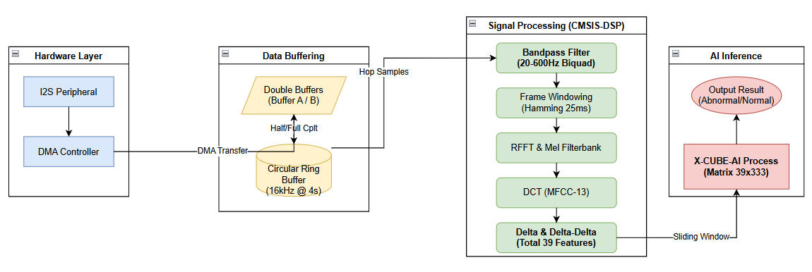
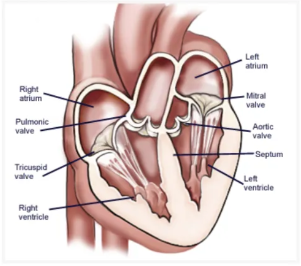
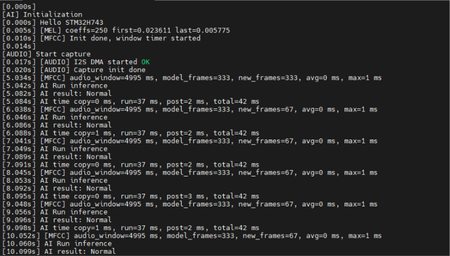

# Abnormal Heart Sound Detection with Edge AI on STM32

> **Nghiên cứu, đánh giá âm thanh tim bất thường trên cơ sở mô hình AI tại biên**
> Graduation thesis (Computer Engineering) at VNU University of Engineering and Technology (UET), Hanoi, 2026
> Author: **Nguyễn Đức Anh** · Supervisor: **Assoc. Prof. Dr. Mai Anh Tuấn**

This repository contains the full source of a **smart digital stethoscope** that captures heart sounds (phonocardiogram, PCG) with a digital MEMS microphone, extracts MFCC features, and classifies each recording as **Normal** or **Abnormal** with a tiny CNN running directly on an **STM32H743** microcontroller. It needs no PC, no cloud and no Internet connection.



---

## Table of contents

- [Motivation](#motivation)
- [Key results](#key-results)
- [System architecture](#system-architecture)
- [Repository structure](#repository-structure)
- [End-to-end workflow](#end-to-end-workflow)
- [Quick start](#quick-start)
- [Known limitations](#known-limitations)
- [Future work](#future-work)
- [References](#references)
- [Acknowledgements](#acknowledgements)

---

## Motivation

According to Vietnam's Ministry of Health, cardiovascular disease causes about **200,000 deaths per year**, which is roughly 33% of all deaths in Vietnam. Auscultation with a stethoscope is still the first screening tool, but it has four problems:

1. Results depend on the subjective experience of the doctor.
2. It is hard to deploy in remote and under-served areas.
3. Commercial AI stethoscopes are expensive and often require a cloud connection.
4. Cloud processing adds latency and risks the privacy of patient data.

This project builds a **low-cost, fully offline** screening device. A 4-stage pipeline runs on the device itself: sensor → DSP → CNN → LED alert.

### Background: where heart sounds come from

The heart has four chambers and four valves (mitral, tricuspid, aortic, pulmonary). Valve closures produce the two main heart sounds:

- **S1** ("lub"): the mitral and tricuspid valves close at the start of systole.
- **S2** ("dub"): the aortic and pulmonary valves close at the end of systole.

Most of their energy is between 10 and 250 Hz. Abnormal hearts can add extra sounds:

- **Murmurs**: turbulent flow through a narrowed or leaking valve, or a septal defect. Useful energy is up to about 600 Hz.
- **S3 and S4 gallops**: low-frequency sounds linked to heart failure or a stiff ventricle.

This is why the system band-pass filters the signal to **20–600 Hz** before extracting features.

<p align="center"></p>
<p align="center"><em>Heart anatomy: chambers and valves (thesis Hình 1.1)</em></p>

---

## Key results

| Item | Value |
|---|---|
| Dataset | PhysioNet/CinC Challenge 2016 (3,153 recordings, 764 subjects) |
| Model | LightWeight CNN (Depthwise-Separable Conv + Lite-SE), **8,026 parameters** |
| Test accuracy (PyTorch, threshold 0.44) | **90.70 %** |
| Sensitivity / Specificity | **91.39 % / 90.00 %** |
| F1-score / AUC | **0.9079 / 0.9627** |
| After 20 % unstructured pruning + INT8 PTQ (`.tflite`) | 24.8 KB, Acc 84.88 %, Sens 83.46 %, Spec 85.24 % |
| On-target footprint (X-CUBE-AI) | Flash **53.16 KiB**, RAM **124.27 KiB** |
| Inference time on STM32H743 @ 480 MHz | ~37 ms per run (~42 ms including copy and post-processing) |
| Update rate | One new prediction every ~1 s (5 s sliding window) |


### Comparison with other tiny architectures

All models below were trained with the same pipeline (MFCC 39 × 333 input). Full details are in [Model/README.md](Model/README.md).

| Model | Acc | Sens | Spec | F1 | AUC | Size (MB) |
|---|---|---|---|---|---|---|
| SqueezeNet | 0.8704 | 0.9536 | 0.7867 | 0.8807 | 0.9427 | 11.22 |
| ShuffleNet | 0.9336 | 0.9470 | 0.9200 | 0.9346 | 0.9660 | 0.74 |
| ShuffleNetV2 | 0.8937 | 0.9470 | 0.8400 | 0.8994 | 0.9379 | 0.47 |
| Inception Tiny | 0.8837 | 0.8278 | 0.9400 | 0.8772 | 0.9459 | 0.36 |
| GoogleNet | 0.8239 | 0.8808 | 0.7667 | 0.8339 | 0.9117 | 0.38 |
| DenseNet201 | 0.9003 | 0.9007 | 0.9000 | 0.9007 | 0.9558 | 0.41 |
| Xception | 0.9635 | 0.9669 | 0.9600 | 0.9637 | 0.9785 | 0.60 |
| MobileNet | 0.9435 | 0.9338 | 0.9533 | 0.9431 | 0.9706 | 0.33 |
| **Lightweight CNN (ours)** | 0.9070 | 0.9139 | 0.9000 | 0.9079 | 0.9627 | **0.30** |

---

## System architecture

```
 ┌──────────────┐  I2S 48 kHz  ┌──────────────────────────── STM32H743VIT6 ───────────────────────────────┐
 │  ICS-43434   │ ───────────▶ │ DMA (circular, double buffer) ─▶ Downsample ─▶ Ring buffer (FIFO)       │
 │ MEMS mic     │              │        │                                                                │
 └──────────────┘              │        ▼  CMSIS-DSP                                                     │
                               │ Band-pass 20–600 Hz (Butterworth 4th order, 2 biquads)                  │
                               │ ─▶ Hamming 25 ms / hop 15 ms ─▶ RFFT ─▶ Mel filterbank ─▶ log ─▶ DCT     │
                               │ ─▶ 13 MFCC + 13 Δ + 13 ΔΔ = 39 features/frame                           │
                               │        │                                                                │
                               │        ▼  sliding window 39 × 333 (≈5 s), refreshed every 67 frames (≈1 s) │
                               │ X-CUBE-AI  LightWeight CNN ─▶ {Normal, Abnormal} ─▶ LED (PA1) + UART log │
                               └─────────────────────────────────────────────────────────────────────────┘
```

| Layer | Choice | Why |
|---|---|---|
| Sensor | **TDK InvenSense ICS-43434**, digital MEMS, I2S 24-bit, SNR 64–66 dB | ADC is built into the sensor, so no analog front-end noise. Breakout modules are easy to find. |
| MCU | **STM32H743VIT6**, Cortex-M7 @ 480 MHz, 2 MB Flash, 1 MB RAM, double-precision FPU | DSP instructions, DMA, multiple I2S/SAI ports, SDMMC, and the ST Edge AI ecosystem (X-CUBE-AI) |
| Power | USB-C 5 V → AMS1117-3.3 LDO | Simple, low-noise supply for the MCU and microphone |
| Storage | microSD (SDMMC + FATFS) | Long recordings for future data collection |
| Board | Round 2-layer PCB, flat bottom side, acoustic via under the mic | The bottom can sit directly on the patient's skin |

---

## Repository structure

```
GraduationThesis/
├── Altium/                      # Hardware: schematics, PCB layouts, libraries, Gerber/CAM outputs
│   ├── HeartSoundI2S/           #   Final design (STM32H743 + ICS-43434, I2S), PCB revisions Ver1 → Ver5
│   └── HeartSoundClone/         #   Early prototype / reference design
├── Model/                       # AI: feature extraction, training, pruning, quantization, conversion
│   ├── *LogExtracMFCC.ipynb     #   Pre-processing + feature datasets: Log-Mel (128), MFCC-13, MFCC-39 (Colab)
│   ├── *Train.ipynb             #   Training and evaluation notebooks (Ver1 → Ver17)
│   ├── *ConvertToTFLite         #   Prune → fine-tune → ONNX → TFLite INT8 (notebooks without extension)
│   ├── model/ trainer/ utils/ data_loader/ config/   # Reusable PyTorch training framework
│   ├── TFLITE/                  #   Exported .pth / .onnx / .tflite artifacts
│   ├── saved/                   #   Training logs and checkpoints per architecture
│   └── mfcc_*/ logmel_*/        #   Pre-computed feature arrays (.npy)
├── STM32Embedded/               # Firmware (STM32CubeIDE projects)
│   ├── [Ver1]GraduationThesis/  #   ★ Final firmware: I2S + DMA + MFCC + X-CUBE-AI inference
│   └── Test*/ SDCard/ USART3/ … #   Bring-up and unit-test projects for each peripheral
├── STM32Cube_FW_H7_V1.12.1/     # ST's STM32H7 firmware package (HAL, CMSIS-DSP, FATFS, examples)
├── physionet2016/               # PhysioNet/CinC Challenge 2016 dataset + reference papers
└── docs/images/                 # Figures used by the READMEs (see docs/images/README.md)
```

Each main folder has its own README with details:

| Folder | README |
|---|---|
| Hardware design | [Altium/README.md](Altium/README.md) |
| AI model | [Model/README.md](Model/README.md) |
| Exported models | [Model/TFLITE/README.md](Model/TFLITE/README.md) |
| Firmware (overview) | [STM32Embedded/README.md](STM32Embedded/README.md) |
| Final firmware | [STM32Embedded/[Ver1]GraduationThesis/README.md](<STM32Embedded/[Ver1]GraduationThesis/README.md>) |
| Dataset | [physionet2016/README.md](physionet2016/README.md) |
| ST firmware package | [STM32Cube_FW_H7_V1.12.1/README.md](STM32Cube_FW_H7_V1.12.1/README.md) |
| Figures | [docs/images/README.md](docs/images/README.md) |

---

## End-to-end workflow

```
PhysioNet 2016 (.wav, 2 kHz)
   │  Model/[Ver5][MFCC]LogExtracMFCC.ipynb  (MFCC-39)   ·   Copy of [Ver5][MFCC13]… (MFCC-13)
   ▼
Band-pass 20–600 Hz → Augmentation (train only) → Log-Mel 128 × T  +  MFCC-13 (13 × 100) / MFCC-39 (39 × 333)
→ SNV normalization → .npy / .h5          (MFCC-39 selected for the final model)
   │  Model/[Ver17][MFCC] Train.ipynb
   ▼
Train LightWeight CNN (PyTorch) → best checkpoint model_best.pth
   │  Model/[Ver10][MFCC][LightCNN] ConvertToTFLite
   ▼
L1 unstructured pruning 20 % → fine-tune → make permanent → ONNX (static graph) → TFLite (INT8 PTQ)
   │  STM32CubeMX → X-CUBE-AI (Analyze / Validate / Generate)
   ▼
network_4.c / network_4_data.c   (generated C code)
   │  STM32Embedded/[Ver1]GraduationThesis
   ▼
Flash STM32H743 → real-time inference, LED + UART output
```

---

## Quick start

### 1. Train or re-export the model (Python)

The notebooks were written for **Google Colab** with Google Drive mounted at
`/content/drive/MyDrive/AutomaticHeartSoundClassification-main` (project) and
`/content/drive/MyDrive/physionet2016` (dataset).

1. Upload `Model/` and `physionet2016/` to Google Drive, or edit `PROJECT_PATH` / `DATASET_PATH` in the first cells.
2. Run `Model/[Ver5][MFCC]LogExtracMFCC.ipynb` to build `mfcc_39_*.h5` and the `label_39_*` CSVs. For the 13-coefficient variant, use `Copy of [Ver5][MFCC13]LogExtracMFCC.ipynb`. All four feature sets (Log-Mel, MFCC-13, MFCC-39) are described in [Model/README.md](Model/README.md#feature-datasets-log-mel-and-mfcc-13-and-39-channels).
3. Run `Model/[Ver17][MFCC] Train.ipynb`. Select the model with `current_config = config_light_cnn_v2`.
4. Run `Model/[Ver10][MFCC][LightCNN] ConvertToTFLite` with `TIMESTAMP` set to your run folder.

Main dependencies: `torch`, `torchvision`, `librosa`, `soundfile`, `scipy`, `h5py`, `scikit-learn`, `onnx==1.17.0`, `onnxruntime==1.18.1`, `onnxsim`, `tensorflow==2.19.0`, `numpy==1.26.4`.

### 2. Build and flash the firmware

1. Install **STM32CubeIDE** (with STM32CubeMX) and the **X-CUBE-AI** pack.
2. Open `STM32Embedded/[Ver1]GraduationThesis` as an existing project.
3. Optional: open the `.ioc` file → *Software Packs → X-CUBE-AI*, select your `.tflite`, then *Analyze* and *Generate Code*.
4. Build, then flash with ST-LINK (SWD).
5. Open a serial terminal on **USART3, 115200 8N1** (PB10 TX / PB11 RX) to watch the log.



### 3. Hardware

Open `Altium/HeartSoundI2S/HeartSoundProject/HeartSoundSTMH7I2S.PrjPcb` in Altium Designer. Fabrication outputs (Gerber / NC drill) are in `Project Outputs for HeartSoundSTMH7I2S/`.

---

## Known limitations

- **Possible overlap between train and test data.** The official PhysioNet `validation/` set (301 recordings, used here as the test set) is a subset of `training-a … training-f`. If those records are not excluded from `label.csv` before the train/validation split, the reported test metrics are optimistic. See [Model/README.md](Model/README.md#notes--known-limitations).
- **On-device features must match training features** (sample rate, window, Mel bands, SNV normalization). Some parameters in the current firmware differ from the training notebooks. See the [parity checklist](<STM32Embedded/[Ver1]GraduationThesis/README.md#training--firmware-parity-checklist>).
- The model only does binary classification (Normal / Abnormal). It does not identify the specific disease.
- The model was trained on recordings from commercial stethoscopes (2 kHz). Recordings from the ICS-43434 board have not yet been clinically validated.

## Future work

- Battery charging and a power-management circuit for portable use
- Long-term recording to microSD to build a local dataset and retrain the model
- More disease classes and clinical validation with recordings from the device itself

---

## References

- G. D. Clifford et al., *Classification of normal/abnormal heart sound recordings: The PhysioNet/Computing in Cardiology Challenge 2016*, CinC 2016.
- A. G. Howard et al., *MobileNets: Efficient CNNs for Mobile Vision Applications*, 2017.
- B. Jacob et al., *Quantization and Training of Neural Networks for Efficient Integer-Arithmetic-Only Inference*, 2017.
- TDK InvenSense, *ICS-43434 Multi-Mode Microphone with I2S Digital Output*, datasheet.
- STMicroelectronics, *X-CUBE-AI / ST Edge AI Core* documentation.

The full reference list (47 items) is in the thesis report.

## Acknowledgements

Thanks to Assoc. Prof. Dr. Mai Anh Tuấn, Eng. Lê Đức (hardware support), Eng. Đào Tuấn Linh and Eng. Nguyễn Hữu Việt Hưng, and the **E3 Research Group**, Faculty of Electronics and Telecommunications, VNU-UET.
