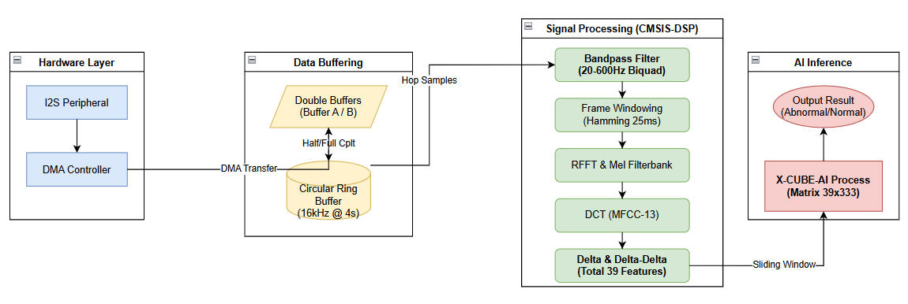

# STM32Embedded: Firmware Projects

STM32CubeIDE projects for the **STM32H743VIT6** board. One project is the final application. The others are small bring-up projects, each used to test one peripheral of the custom PCB before integration.

## Projects

| Project | Peripherals (from `.ioc`) | Purpose |
|---|---|---|
| **[`[Ver1]GraduationThesis/`](<[Ver1]GraduationThesis/README.md>)** ★ | I2S1 + DMA, USART3, X-CUBE-AI, CMSIS-DSP | **Final firmware**: real-time capture → band-pass → MFCC 39 × 333 → LightCNN inference → LED + UART |
| `LogmeLProject/` | I2S1 + DMA | CubeMX skeleton for the Log-Mel/MFCC firmware (peripherals configured, empty main loop) |
| `TestSTM32H7LED/` | GPIO | First power-on test: blink LEDs on PA1 and PD7 (500 ms) |
| `TestBoard/` | GPIO | Bring-up test of the custom PCB: blink the result LED (PA1) |
| `USART3/` | USART3 (PB10/PB11) | UART debug output at 115200 baud |
| `TestICSBoard/` | I2S1 + DMA | Read ICS-43434 samples over I2S with DMA. Includes a commented-out sound-level → LED test. |
| `TestICSLED/` | I2S1 + DMA, TIM2 PWM | Compute the microphone sound level and drive an RGB LED via PWM (TIM2 CH1/3/4). Also contains a CMake build. |
| `SDCard/` | SDMMC1 + FATFS | microSD read/write test (4-bit SDMMC, PC8–PC12, PD2) |
| `YTICSSDProject/` | I2S1 + DMA, SDMMC1 + FATFS, TIM2 | Record ICS-43434 audio (mono, right channel) to `w_000.wav` on the SD card for data collection |
| `SdCardICS4343/` | – | Empty workspace placeholder (only `.project`) |

## Common hardware configuration

| Item | Value |
|---|---|
| MCU | STM32H743VIT6, SYSCLK **480 MHz** |
| Microphone | ICS-43434 on I2S1 (master RX, 48 kHz): WS = PA4, CK = PA5, SDI = PA6 |
| LED | PA1 (Abnormal indicator) |
| UART | USART3 TX = PB10, RX = PB11, 115200 8N1 |
| SD card | SDMMC1 D0–D3 = PC8–PC11, CK = PC12, CMD = PD2 |
| Debug | ST-LINK over SWD |

## Toolchain

- **STM32CubeIDE** 1.13 or later (includes STM32CubeMX)
- **STM32Cube FW_H7 V1.12.1**: a copy is in [`../STM32Cube_FW_H7_V1.12.1`](../STM32Cube_FW_H7_V1.12.1/README.md)
- **X-CUBE-AI / ST Edge AI Core 2.2** (only for the final project)
- **CMSIS-DSP**: `arm_math`, the biquad filter and the MFCC feature-extraction helpers

## Opening a project

1. *File → Import → General → Existing Projects into Workspace*, then select the project folder.
2. Double-click the `.ioc` file to view or modify the pin and clock configuration in CubeMX. Keep your code inside `/* USER CODE BEGIN … */` blocks so it survives regeneration.
3. *Project → Build*, then *Run → Debug* (ST-LINK).

> `Debug/` folders contain build outputs (`.elf`, `.map`, objects). You can delete and rebuild them.
