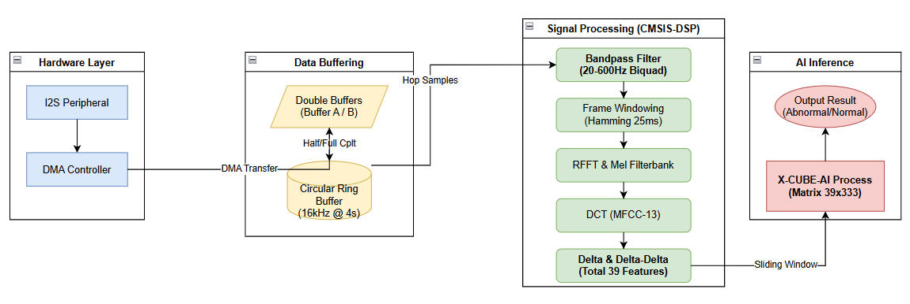
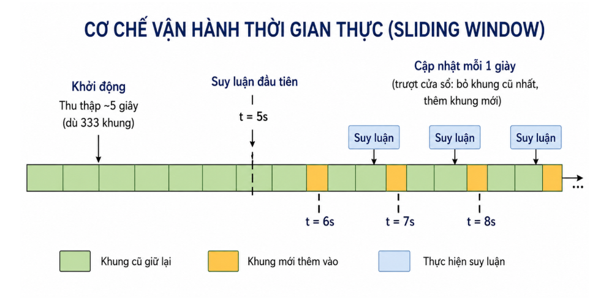
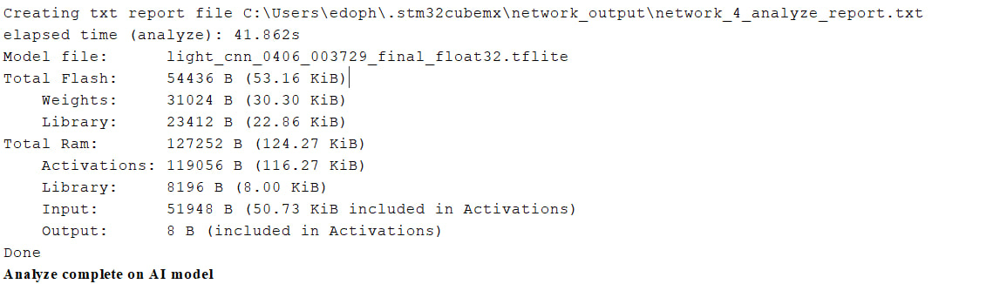

# [Ver1]GraduationThesis: Final Edge-AI Firmware

Real-time heart-sound classification on the **STM32H743VIT6** custom board:

```
ICS-43434 ─I2S/DMA─▶ ring buffer ─▶ band-pass ─▶ MFCC (13+Δ+ΔΔ) ─▶ 39×333 sliding window ─▶ LightCNN (X-CUBE-AI) ─▶ LED + UART
```



## Source layout

```
[Ver1]GraduationThesis/
├── [Ver1]GraduationThesis.ioc        # CubeMX config: I2S1, DMA, USART3, X-CUBE-AI, 480 MHz clock
├── Core/
│   ├── Inc/
│   │   ├── audio_capture.h            # Sample rates, frame/hop, DMA and ring-buffer sizes
│   │   ├── mfcc_extract.h             # MFCC parameters (FFT 256, 13 MFCC, Mel bands, 39×333 window)
│   │   └── debug_uart.h               # Timestamped printf-style logging over USART3
│   └── Src/
│       ├── main.c                     # Init + main loop (frame/hop scheduling, inference trigger)
│       ├── audio_capture.c            # I2S DMA callbacks (half/full) → downsample → ring buffer (FIFO)
│       ├── mfcc_extract.c             # CMSIS-DSP biquad band-pass, window, RFFT, Mel, DCT, Δ/ΔΔ
│       └── debug_uart.c
├── X-CUBE-AI/App/
│   ├── app_x-cube-ai.c                # MX_X_CUBE_AI_Init/Process, pre_process (copy MFCC), post_process (LED)
│   ├── network_4*.c/.h                # ★ Generated network in use (light_cnn_0406_003729_final_float32.tflite)
│   ├── network_4_generate_report.txt  # Layer-by-layer report: MACC, weights, activations
│   └── network*, network_3*           # Earlier generated networks (kept for reference)
├── Middlewares/ST/AI/                 # X-CUBE-AI runtime library
├── LightCNN_0307_173933/              # Older ONNX/TFLite model used during bring-up
├── *.tflite, *.onnx                   # Model files imported into CubeMX
└── STM32H743VITX_FLASH.ld / _RAM.ld   # Linker scripts
```

## Runtime behavior

1. **Init.** HAL, clocks (480 MHz), DMA, I2S1, USART3 and the X-CUBE-AI network. Then `Preprocessing_Init()` builds the filter, window, Mel and DCT tables.
2. **Capture.** `HAL_I2S_Receive_DMA` runs in **circular mode at 48 kHz**. On every *half-transfer* and *transfer-complete* interrupt, one half of the double buffer is processed while DMA fills the other half. The left channel is downsampled (`DOWNSAMPLE_RATIO = 12`) and pushed into a 24,000-sample **ring buffer**.
3. **Feature extraction.** The main loop keeps a 25 ms frame and slides it by one hop (15 ms) each time enough samples are in the ring buffer. `compute_mfcc_one_frame()` outputs 39 values, which are appended to `mfcc_final_features[39][333]`.
4. **Inference.**
   - The first inference runs once 333 frames (≈ 5 s) have been collected.
   - After that, inference runs every `INFER_STEP_FRAMES = 67` new frames (≈ 1 s), on a sliding window where the oldest frames are dropped.
5. **Decision.** `post_process()` compares the two logits (`argmax`).
   - **Abnormal**: LED on **PA1** turns on, and `AI result: Abnormal` is printed.
   - **Normal**: LED off.



## Measured performance

| Item | Value |
|---|---|
| Model | `light_cnn_0406_003729_final_float32.tflite`, 7,754 params, 1.86 M MACC |
| Flash | **53.16 KiB** (weights 30.30 KiB + runtime library 22.86 KiB) |
| RAM | **124.27 KiB** (activations 116.27 KiB including the 50.73 KiB input buffer, + library 8 KiB) |
| Inference time | **~37 ms** (`run`), **~42 ms** per cycle including copy and post-processing |
| Real-time budget | 1 s per update. Inference uses about 4 % of it. MFCC per frame is ≤ 1 ms. |



Example UART log (USART3, 115200 8N1):

```
[0.000s] Hello STM32H743
[0.005s] [MEL] coeffs=250 first=0.023611 last=0.005775
[0.017s] [AUDIO] I2S DMA started OK
[5.034s] [MFCC] audio_window=4995 ms, model_frames=333, new_frames=333, avg=0 ms, max=1 ms
[5.042s] AI Run inference
[5.082s] AI result: Normal
[5.084s] AI time copy=0 ms, run=37 ms, post=2 ms, total=42 ms
[6.038s] [MFCC] audio_window=4995 ms, model_frames=333, new_frames=67, ...
```

## Build and flash

1. Install STM32CubeIDE and the **X-CUBE-AI** pack (ST Edge AI Core 2.2 was used).
2. *File → Import → Existing Projects into Workspace*, then select this folder.
3. To change the model:
   1. Open the `.ioc` → *Middleware and Software Packs → X-CUBE-AI*.
   2. Add a network with your `.tflite`.
   3. Click *Analyze* (and *Validate on desktop/target* if you want).
   4. Click *Generate Code*.
   5. Update the `network_4` names in `app_x-cube-ai.c` if the network name changes.
4. Build, then flash with ST-LINK.
5. Open a serial terminal at 115200 baud and place the board's flat side on the chest (mitral or aortic point).

## Training ↔ firmware parity checklist

The model is accurate only if the on-device features match the Python training features. These are the values currently in the code, compared with the training notebooks:

| Parameter | Training (`Model/…LogExtracMFCC.ipynb`) | Firmware (this project) | Where to change |
|---|---|---|---|
| Sample rate | 2,000 Hz | `PROC_SAMPLE_RATE = 4000` (48 kHz / 12) | `audio_capture.h` |
| Downsampling | `librosa.resample` (anti-aliased) | Decimation (every 12th sample, no low-pass) | `audio_capture.c` → `audio_push_to_ring` |
| Band-pass coefficients | Butterworth 20–600 Hz designed at fs = 2 kHz | Comment says "designed at fs = 16 kHz" | `filter_coeffs[]` in `mfcc_extract.c` |
| Window | Hamming 25 ms | `Window_Init(..., WINDOW_HANN)` | `Preprocessing_Init()` |
| Mel bands | 128 | `NUM_MELS = 64` | `mfcc_extract.h` |
| Log | natural log | natural log (`LOGMELSPECTROGRAM_SCALE_LOG`) | ✓ matches |
| Δ / ΔΔ | `librosa.feature.delta` (width 9) | `DELTA_N = 4` (width 9) | ✓ matches |
| Normalization | SNV (z-score of the whole 39 × 333 matrix) | not applied before inference | `pre_process()` in `app_x-cube-ai.c` |
| Decision threshold | 0.4414 (ROC-optimal) | `argmax` (0.5) | `post_process()` |

To regenerate the biquad coefficients for a given sample rate:

```python
from scipy.signal import butter
sos = butter(4, [20, 600], btype="bandpass", fs=4000, output="sos")  # use your PROC_SAMPLE_RATE
# CMSIS-DSP DF1 order per stage: {b0, b1, b2, -a1, -a2}
print([[s[0], s[1], s[2], -s[4], -s[5]] for s in sos])
```

> Note: `butter(4, …, btype="bandpass")` returns 4 second-order sections (a band-pass doubles the order), so `NUM_STAGES` must be set to `len(sos)`.
